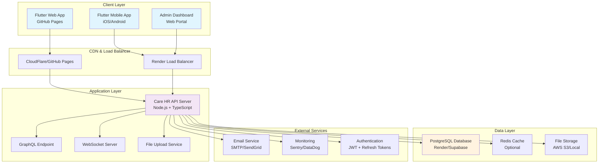
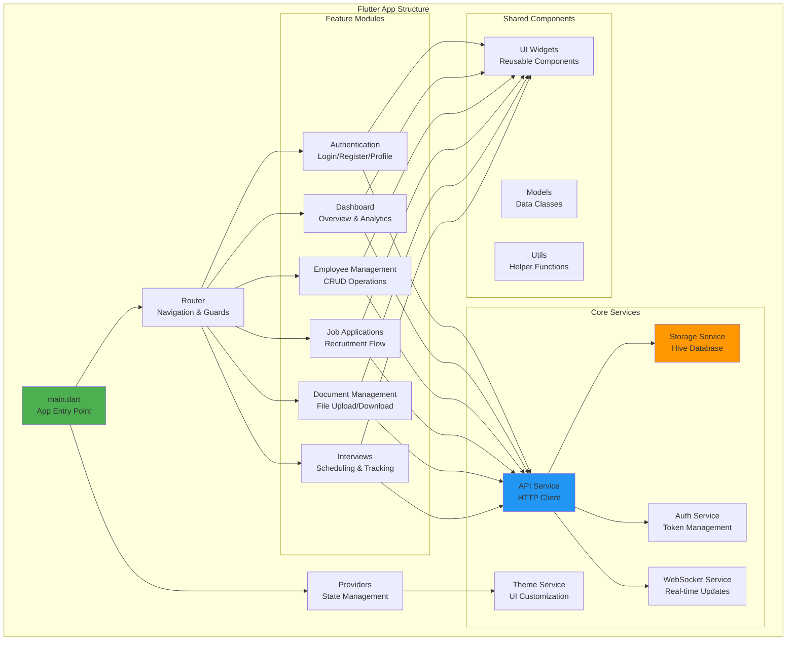
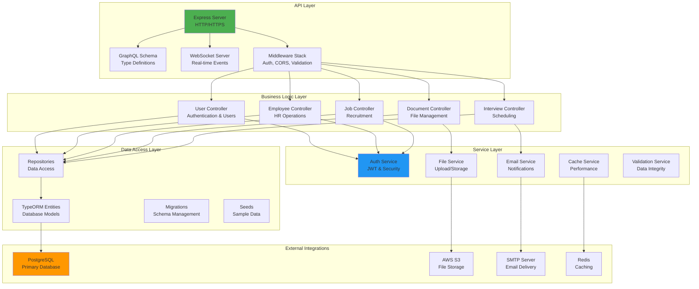
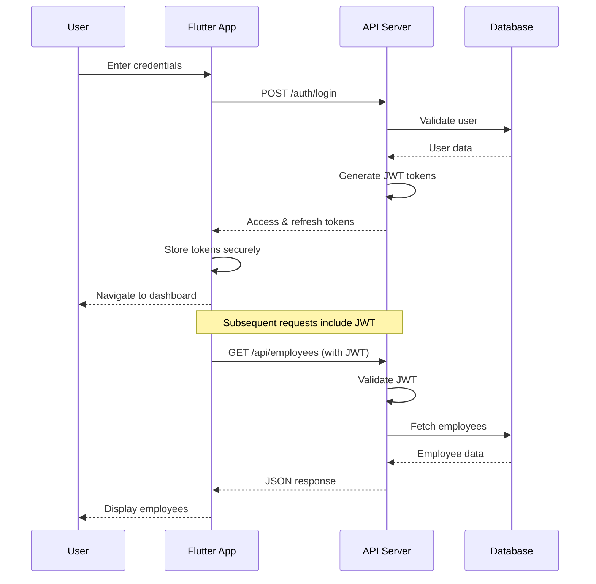
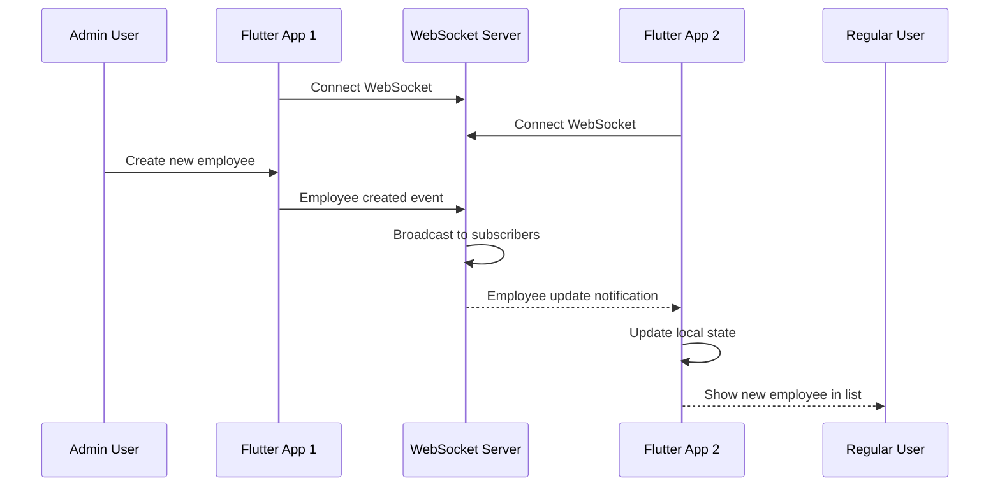
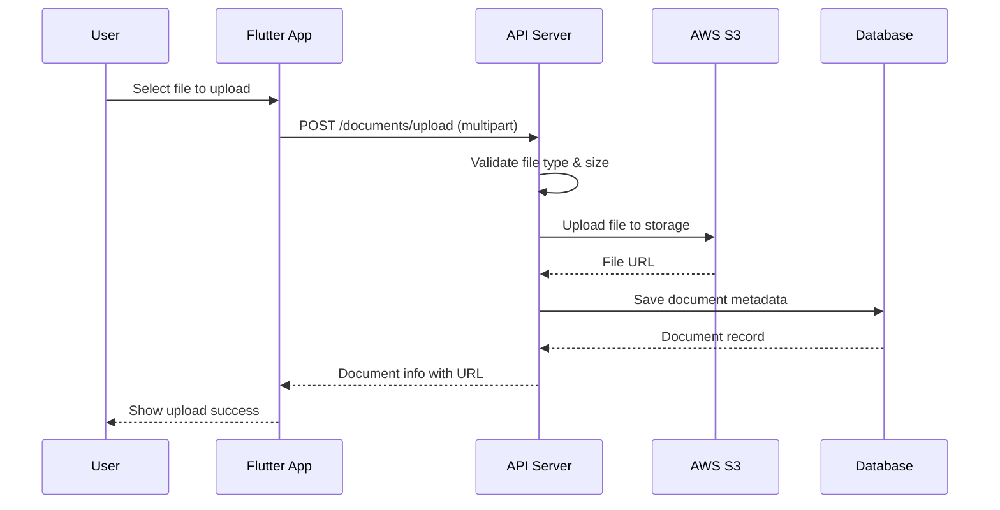
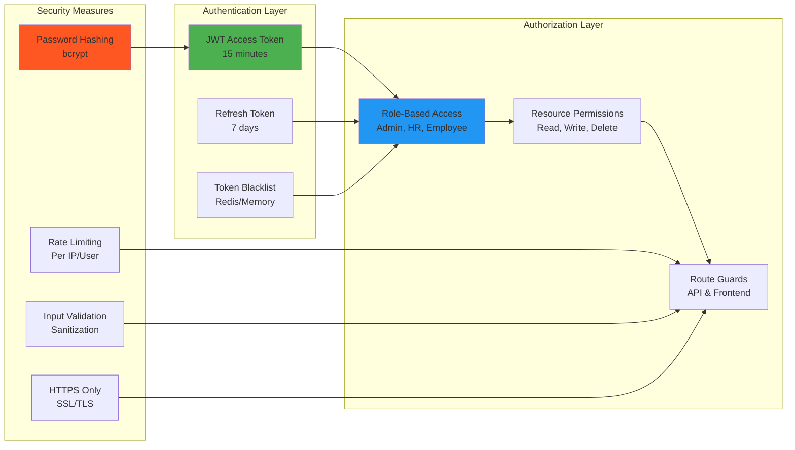
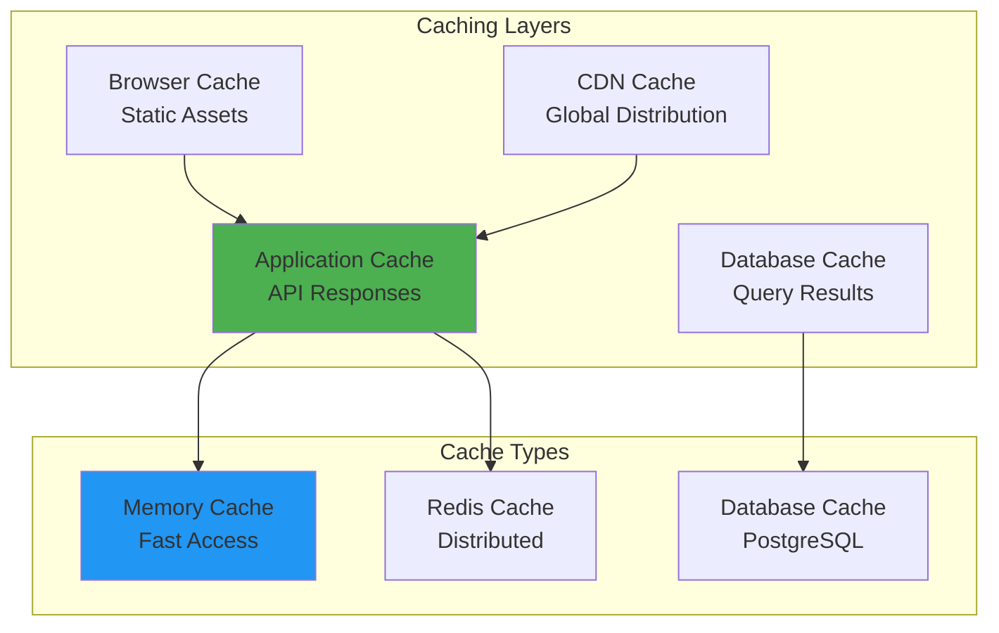
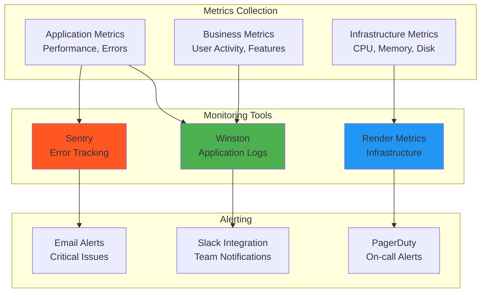
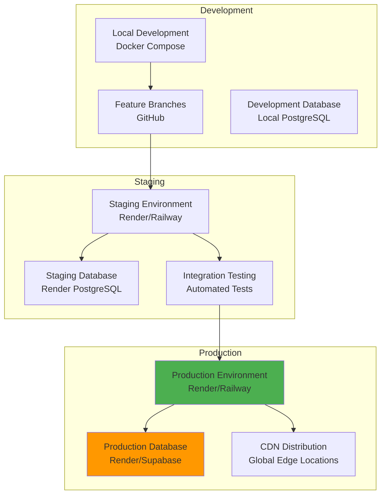

# Care HR System Architecture

## System Overview

The Care HR system is a modern, scalable enterprise HR management solution built with a microservices architecture, featuring a Flutter frontend, Node.js/TypeScript backend, and PostgreSQL database.

## High-Level Architecture



## Technology Stack

### Frontend (Flutter)
- **Framework**: Flutter 3.24.3+ (Dart)
- **State Management**: Provider pattern with ChangeNotifier
- **Routing**: GoRouter with authentication guards
- **Local Storage**: Hive (NoSQL embedded database)
- **HTTP Client**: Dio with interceptors
- **Real-time**: WebSocket integration
- **UI Components**: Material Design 3

### Backend (Node.js/TypeScript)
- **Runtime**: Node.js 18+ with TypeScript
- **Framework**: Express.js with middleware
- **ORM**: TypeORM with PostgreSQL
- **Authentication**: JWT with refresh tokens
- **API Styles**: RESTful + GraphQL
- **Real-time**: WebSocket (ws library)
- **File Handling**: Multer with AWS S3 integration
- **Validation**: class-validator and joi

### Database & Storage
- **Primary Database**: PostgreSQL 15+
- **Caching**: Redis (optional) + in-memory caching
- **File Storage**: AWS S3 or local filesystem
- **Search**: PostgreSQL full-text search
- **Backups**: Automated daily backups

### Infrastructure & DevOps
- **Backend Hosting**: Render/Railway/Heroku
- **Frontend Hosting**: GitHub Pages/Vercel/Netlify
- **Database Hosting**: Render PostgreSQL/Supabase
- **CI/CD**: GitHub Actions
- **Monitoring**: Sentry, Winston logging
- **Security**: Helmet.js, CORS, rate limiting

## Detailed Component Architecture

### Frontend Architecture



### Backend Architecture



## Data Flow Patterns

### Authentication Flow



### Real-time Updates Flow



### File Upload Flow



## Security Architecture

### Authentication & Authorization



### Data Protection

1. **Encryption at Rest**
   - Database: PostgreSQL with encryption
   - Files: AWS S3 server-side encryption
   - Sensitive data: Application-level encryption

2. **Encryption in Transit**
   - HTTPS/TLS 1.3 for all communications
   - WSS (WebSocket Secure) for real-time data
   - API token encryption

3. **Access Controls**
   - Multi-factor authentication (planned)
   - Role-based permissions
   - IP whitelisting (configurable)
   - Session management

## Performance Architecture

### Caching Strategy



### Database Optimization

1. **Indexing Strategy**
   ```sql
   -- Primary indexes for fast lookups
   CREATE INDEX idx_employees_email ON employees(email);
   CREATE INDEX idx_users_role ON users(role);
   CREATE INDEX idx_jobs_status ON jobs(status, created_at);
   CREATE INDEX idx_applications_status ON job_applications(status);
   ```

2. **Query Optimization**
   - Prepared statements
   - Connection pooling
   - Lazy loading with TypeORM
   - Database query monitoring

3. **Scaling Strategy**
   - Vertical scaling (CPU/Memory)
   - Read replicas (future)
   - Connection pooling
   - Database sharding (if needed)

## Monitoring & Observability

### Application Monitoring



### Health Monitoring

1. **Health Checks**
   - `/health` endpoint with database connectivity
   - Service health indicators
   - Dependency status checking

2. **Logging Strategy**
   - Structured logging with Winston
   - Different log levels (error, warn, info, debug)
   - Centralized log aggregation
   - Log rotation and archival

3. **Performance Monitoring**
   - Response time tracking
   - Database query performance
   - Memory and CPU usage
   - User experience metrics

## Deployment Architecture

### Multi-Environment Setup



### CI/CD Pipeline

1. **Continuous Integration**
   - Automated testing on pull requests
   - Code quality checks
   - Security vulnerability scanning
   - Build verification

2. **Continuous Deployment**
   - Automatic deployment to staging
   - Manual promotion to production
   - Blue-green deployment strategy
   - Rollback capabilities

## Scalability Considerations

### Horizontal Scaling

1. **Application Layer**
   - Stateless server design
   - Load balancer distribution
   - Container orchestration (future)
   - Microservices architecture (future)

2. **Database Layer**
   - Connection pooling
   - Read replicas
   - Database partitioning
   - Caching strategies

### Performance Optimization

1. **Frontend Optimization**
   - Code splitting and lazy loading
   - Image optimization
   - Caching strategies
   - Progressive Web App features

2. **Backend Optimization**
   - Database query optimization
   - API response caching
   - Compression middleware
   - Connection pooling

## Future Architecture Enhancements

1. **Microservices Migration**
   - Service decomposition
   - API gateway implementation
   - Service mesh architecture
   - Event-driven communication

2. **Advanced Features**
   - Machine learning integration
   - Advanced analytics
   - Mobile offline capabilities
   - Real-time collaboration features

3. **Infrastructure Improvements**
   - Container orchestration (Kubernetes)
   - Service discovery
   - Distributed tracing
   - Advanced monitoring and alerting

This architecture provides a solid foundation for the Care HR system while allowing for future growth and enhancement.